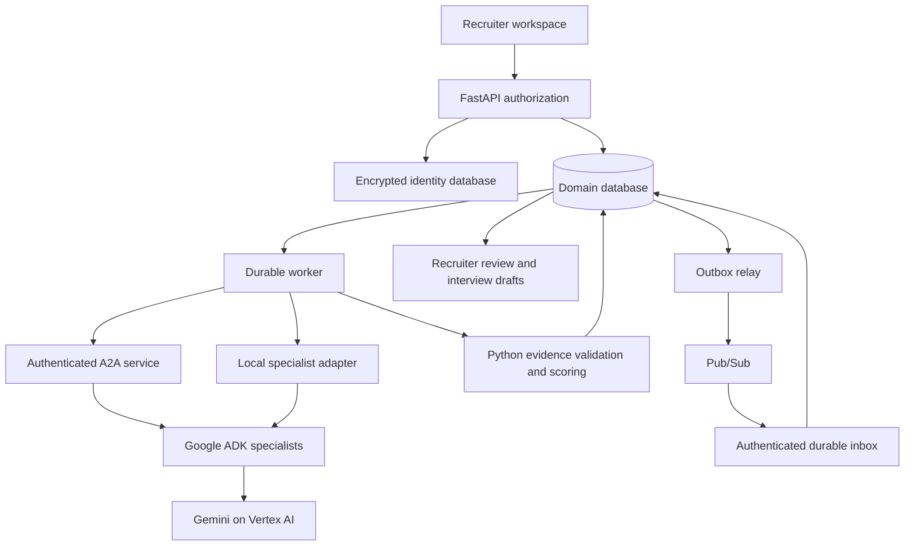

# Architecture and ownership

## Reasoning versus code

| Decision | Owner | Implementation |
|---|---|---|
| Interpret ambiguous recruiter intent | ADK intent agent | Returns a permitted action proposal, no execution authority |
| Extract professional skills and job requirements | Resume/job specialists | Schema-constrained, no tools |
| Assess evidence against approved requirements | Matcher specialist | Per-requirement statuses and citations |
| Assign tenant and permissions | Verified API context | Local token or RS256 OIDC claims |
| Approve source privacy and job rubric | Recruiter | Explicit recorded action |
| Schedule work and recover from crashes | Python worker and database | Leases, fencing and bounded attempts |
| Compute scores, coverage and bounds | Python | Frozen weights, stable ordering |
| Create an interview proposal | Python policy | Score ≥80, coverage ≥90%, no unresolved required criterion or documented gap |
| Advance or hold | Recruiter | Append-only decision history |
| Send outreach or create calendar events | Not enabled | Drafts only in this release |
| Promote matcher changes | Accountable release process | Offline report; no automatic model/prompt changes |

The ADK intent agent is available for integration but the current UI deliberately sends typed commands. No model is required to decide which handler a typed API action invokes.

## Score definition

For approved requirement weights summing to 1:

- supported = 1 with evidence
- partial = 0.5 only under approved equivalence policy (no equivalence rules are enabled in this MVP)
- not_met = 0 with explicit contrary evidence
- unknown = null

`score = 100 × Σ(weight × known value)`

`coverage = Σ(weight for known assessments)`

`upper bound = score + 100 × (1 − coverage)`

Unknowns are not silently reclassified as failure. The upper bound is a missing-evidence bound, not a confidence interval. Scores are not calibrated probabilities. All recommendations require review.

## Persistence and invariants

Domain tables separate jobs, candidates, workflows, matches, decisions, proposals, audit, feedback, idempotency receipts, outbox/inbox and agent operations. Identity/source text is encrypted in a second database. Raw PDF/DOCX bytes are discarded after extraction. The API process has both connections for privacy ingestion; dedicated production identity service separation remains a release gate.

Jobs and candidates have revision fields; this initial API freezes each at revision 1 and requires a new record for edits. It does not yet implement a full revision lineage API. Match runs freeze the approved job and candidate set; no in-place profile edits are exposed.

A workflow and outbox record commit atomically. The worker makes model/network calls outside database transactions. Final writes lock the candidate and check its liveness plus workflow fence. Deletion locks that same candidate first and blocks late match writes. Partial match results survive retries and are unique per run/candidate.

Each A2A operation uses a deterministic task ID derived from the configured tenant and logical operation ID. Durable lookup reconciles lost responses. The result is committed before responding. No external business effect is performed by an agent.

## Explicit simplifications

- PostgreSQL is the target database; SQLite is only for the synthetic one-worker demo/tests.
- The current worker and A2A instance each serve one configured tenant; API isolation is tested with multiple contexts.
- A2A task rows live in the domain schema for this local release. Separate production task/session service roles are not implemented.
- ADK sessions are per-inference and ephemeral. The workflow database, not ADK conversation history, is the recovery source.
- The candidate corpus is explicitly selected and limited to 50. There is no vector index, retrieval recall claim or large-corpus ranking claim.
- Regex redaction is a preview helper, not an anonymization guarantee. Manual approval is mandatory before inference.
- Files are extracted in-process under byte/page limits. Sandboxed extraction, malware scanning and OCR are release gates.
- Analytics are deterministic tenant aggregates with cohort suppression. Engagement is an approved FAQ/draft fallback. Neither needs an LLM for the current narrow functionality.

## Sources checked while implementing

- https://github.com/google/adk-python
- https://adk.dev/agents/llm-agents/
- https://adk.dev/a2a/quickstart-exposing/
- https://github.com/a2aproject/a2a-python
- https://a2a-protocol.org/latest/specification/
- https://www.postgresql.org/docs/16/ddl-rowsecurity.html
- https://docs.cloud.google.com/pubsub/docs/subscription-overview

Installed SDK signatures and actual A2A exchanges were used to verify the selected package interfaces. Dependency versions are frozen in `requirements.lock.txt` and `frontend/package-lock.json`; cloud model and regional availability must be verified in your account.
